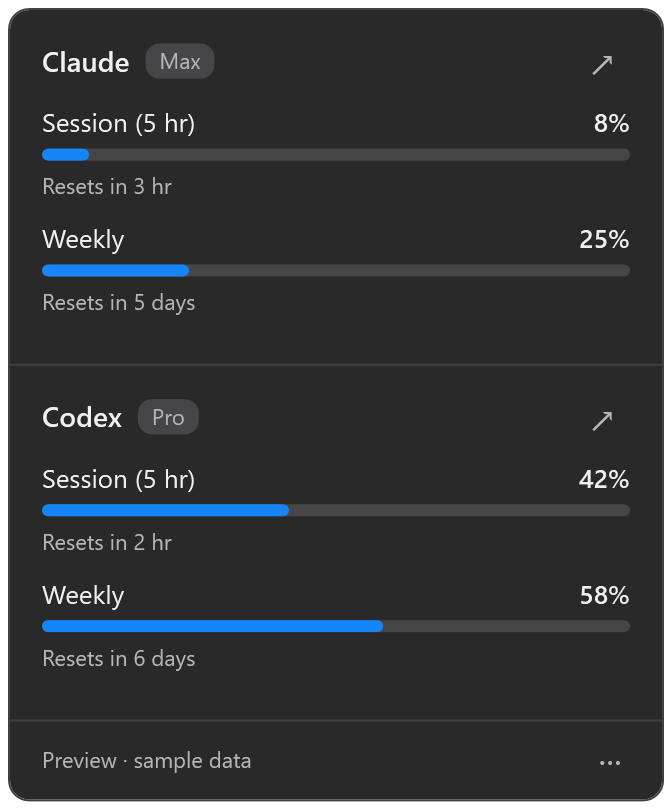

# AI Meter

Claude and Codex plan usage at a glance, in the menu bar or top bar.

- [`macOS/`](macOS/): SwiftUI menu bar app (macOS 14+).
- [`ubuntu/`](ubuntu/): native GNOME Shell extension for Ubuntu 24.04, with no Python dependency.
- [`windows/`](windows/): C# WPF notification-area app for Windows 11.

The apps read the sign-ins that Claude Code and the Codex CLI already store locally,
show the percent **used** of each provider's tightest limit, and refresh every
5 minutes.

## Screenshots

### macOS

### Ubuntu

### Windows

## Install and use

Follow the [macOS guide](macOS/README.md), [Ubuntu guide](ubuntu/README.md), or
[Windows guide](windows/README.md).
macOS builds need Swift 6 and macOS 14 or later. Ubuntu needs GNOME Shell 46,
GJS, and libsoup 3. Windows builds use Visual Studio 2026 Community and .NET 10.
Sign in with the provider CLIs before use.

This is an experimental, independent project. It is not affiliated with or
endorsed by Anthropic, OpenAI, Apple, Canonical, or GNOME. Provider interfaces
can change without notice. Use the provider's own page to confirm usage.

## Security and privacy

AI Meter reads local credentials and uses them to request usage data. On Ubuntu and Windows,
it also runs the installed Codex CLI, which can refresh credentials and write
its own state. AI Meter has no telemetry code; the CLI and provider services
have their own settings and policies.

Read the [security policy](SECURITY.md), [disclaimers](DISCLAIMER.md), and
[release checks](RELEASING.md) before deployment. Do not post tokens, credential
files, or unedited logs in issues.

## Contribute

See [CONTRIBUTING.md](CONTRIBUTING.md) for development, tests, and contribution
terms. Use [GitHub issues](https://github.com/mattcurfman/ai_meter/issues) for
non-security bugs and feature requests.

## License

Copyright 2026 Matt Curfman and AI Meter contributors.

The project source, scripts, documentation, and project-owned screenshots are
licensed under the [Apache License, Version 2.0](LICENSE). See [NOTICE](NOTICE)
for attribution. Third-party software and trademarks retain their own terms.
The software is provided without warranty, as stated in the license.
