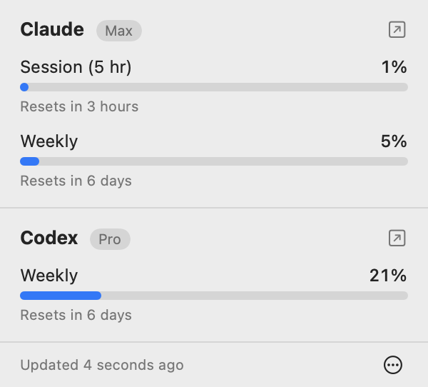
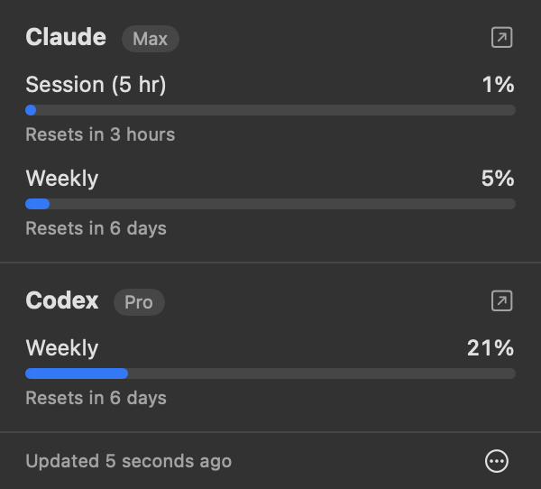

# AI Meter for macOS

A menu bar app that shows Claude and Codex plan usage at a glance (`C 8%  X 0%`).
The label shows each provider's tightest window; click it to see every window,
when it resets, and links to each provider's usage page.

| Light | Dark |
| --- | --- |
|  |  |

```sh
./build_app.sh            # builds "build/AI Meter.app"
./build_app.sh --install  # copies it to ~/Applications and launches it
```

Turn on **Open at Login** from the ••• menu in the panel.

Builds require a Swift 6 toolchain and macOS 14 or later. The script creates
an ad-hoc-signed app, not a notarized release. LICENSE and NOTICE are included
in the app bundle. See the [release checks](../RELEASING.md) before distribution.

## Run a local build on another Mac

**Use this binary at your own risk.** Treat it as an unsigned binary for trust
purposes: its ad-hoc signature does not identify a verified developer. It has
no Apple Developer ID signature and is not notarized by Apple. Only run a build
that you made yourself or received from a source you trust. Read the
[disclaimers](../DISCLAIMER.md) before use.

Copy the complete `AI Meter.app` bundle, not just the executable inside it.
From this directory, create a ZIP file:

```sh
ditto -c -k --keepParent "build/AI Meter.app" "build/AI-Meter.zip"
```

On the other Mac, extract the ZIP and move the app to `/Applications` or
`~/Applications`. The Mac needs macOS 14 or later and a compatible processor.
The build script builds for the current Mac's architecture. An Apple silicon
build needs an Apple silicon Mac. An Intel build needs an Intel Mac or Rosetta
on an Apple silicon Mac. Sign in to the Claude and Codex CLIs on each Mac;
do not copy credentials with the app.

If macOS blocks the app, use **System Settings → Privacy & Security → Open
Anyway** after you try to open it. Alternatively, for a build you trust, remove
the download quarantine attribute from this app only:

```sh
xattr -dr com.apple.quarantine "/Applications/AI Meter.app"
open "/Applications/AI Meter.app"
```

For an app in your user Applications folder, use:

```sh
xattr -dr com.apple.quarantine "$HOME/Applications/AI Meter.app"
open "$HOME/Applications/AI Meter.app"
```

Removing quarantine bypasses the quarantine-based opening check. It does not
make the app safe, verify its source, or add a Developer ID signature or
notarization. It does not fix an invalid signature, an incompatible processor,
or a managed-device restriction. Do not disable Gatekeeper globally.

## Where the numbers come from

- **Claude**: the OAuth token that Claude Code keeps in the login keychain
  (`Claude Code-credentials`), sent to `api.anthropic.com/api/oauth/usage`.
- **Codex**: the ChatGPT token in `~/.codex/auth.json` (or `$CODEX_HOME`),
  sent to `chatgpt.com/backend-api/wham/usage`.

AI Meter only reads these credentials; it never refreshes or writes them. If a
token expires, use the provider CLI to sign in or refresh it. Both endpoints are
undocumented, so AI Meter waits five minutes after a successful request before
it checks again. Opening the panel does not send a request.

After a failure, each provider waits independently before it tries again. The
random delay grows from 5–10 minutes to 10–20, 20–40, then 30–60 minutes for
further failures. Claude's `Retry-After` header can require a longer delay.
The scheduler checks once per minute after the current requests finish.
A successful request restores the five-minute interval. Restarting the app
clears the retry state.

A failed check replaces the previous result with an error. The footer shows
the last check time, not the time of the last successful response.

## Test retry delays

Run `swift test` from this directory. The tests check delay growth, jitter,
the delay cap, reset after success, and `Retry-After` seconds and dates.
They do not send network requests.

Read the [security policy](../SECURITY.md) and [disclaimers](../DISCLAIMER.md).
This project is licensed under [Apache-2.0](../LICENSE).
