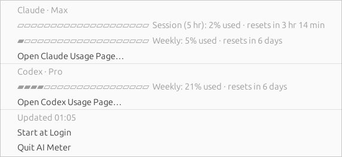
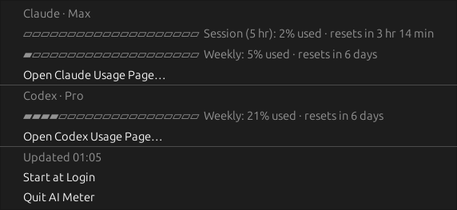

# AI Meter for Ubuntu 24.04

A top bar indicator that shows Claude and Codex plan usage at a glance
(`C 8%  X 21%`, percent **used** of each provider's tightest limit). Click it
to see every limit and when it resets.




These show the menu drawn by GTK with Ubuntu's Yaru themes. In the top bar, GNOME
Shell draws the same items in its own menu style.

```sh
./install.sh              # installs to ~/.local/share/ai-meter and starts it
./install.sh --autostart  # same, and starts it at login
./uninstall.sh
ai-meter --once           # print usage in the terminal
```

It uses the AppIndicator support that Ubuntu's GNOME desktop enables by default.
`install.sh` installs `python3-gi`, `gir1.2-gtk-3.0` and
`gir1.2-ayatanaappindicator3-0.1` with `sudo apt` if they're missing.

## Where the numbers come from

- **Claude**: the OAuth token Claude Code keeps in `~/.claude/.credentials.json`
  (or `$CLAUDE_CONFIG_DIR`), sent to `api.anthropic.com/api/oauth/usage`.
- **Codex**: the ChatGPT token in `~/.codex/auth.json` (or `$CODEX_HOME`), sent
  to `chatgpt.com/backend-api/wham/usage`.

AI Meter only reads these credentials; it never refreshes or writes them. If a
token expires, running `claude` or `codex` once refreshes it. Both endpoints are
undocumented, so AI Meter refreshes only every 5 minutes.
