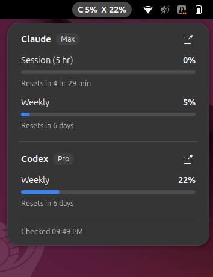

# AI Meter for Ubuntu 24.04

A native GNOME Shell 46 extension that shows Claude and Codex plan usage in the
top bar. It uses JavaScript, GJS, St, Gio, and libsoup. It does not use Python,
GTK, AppIndicator, Node.js, or a background service.

Click `C 5%  X 21%` to open the usage panel. The bars are blue below 70%, orange
from 70%, and red from 90%. Each row shows the percentage used and the reset time.
The top bar shows the highest percentage for each provider.



## Install

From this directory, run:

```sh
./install.sh
```

The installer copies the extension to
`~/.local/share/gnome-shell/extensions/ai-meter@ai-meter.local` and tries to enable
it. On the first installation, log out and back in if GNOME does not detect it.
Then run:

```sh
gnome-extensions enable ai-meter@ai-meter.local
```

Enabled extensions start at login. To stop AI Meter, disable it:

```sh
gnome-extensions disable ai-meter@ai-meter.local
```

To remove it, run `./uninstall.sh`. After an update, log out and back in to load
the new JavaScript code. The installer removes the old Python indicator, launcher,
and autostart entry. It does not remove system packages or CLI credentials.

## Credentials and requests

- **Claude:** reads `~/.claude/.credentials.json`, or the directory set by
  `CLAUDE_CONFIG_DIR`. It sends the saved subscription access token to
  `https://api.anthropic.com/api/oauth/usage` through libsoup.
- **Codex:** starts `codex app-server`, asks it to refresh its credentials with
  `account/read`, then requests `account/rateLimits/read`. It closes the process
  after each check. Codex must support app-server and use a ChatGPT account.
  The extension finds `codex` in `PATH`, then checks `~/.local/bin/codex`.

The extension never writes credentials itself. Codex manages its own token
refresh. Claude still needs a usable saved access token. A working CLI session
does not mean that this file contains one. An HTTP 403 response means that the
usage API denied access; it does not mean that the CLI login expired.

`CLAUDE_CONFIG_DIR`, `CODEX_HOME`, and `PATH` come from the GNOME Shell session.
Variables set only in a terminal are not available to the extension. If you use
custom paths, set them in your desktop login environment and log in again.

Both providers refresh every five minutes. Requests are asynchronous and have
timeouts. A failed request keeps the last successful usage, marks it as saved,
and adds `!` to the top-bar label. Disabling the extension cancels requests,
stops the Codex child process, and removes the timers and panel.

## Check and test

Run from this directory. These commands use the system GJS runtime, not Python
or Node.js:

```sh
gjs -m tests/usage.test.js  # Offline tests with a local Codex protocol fixture
gjs -m check-usage.js      # Live usage check with your current credentials
bash -n install.sh uninstall.sh
```

The live check prints usage values only; it does not print tokens. The extension
is tested on GNOME Shell 46. Other Shell versions are not yet declared supported.
