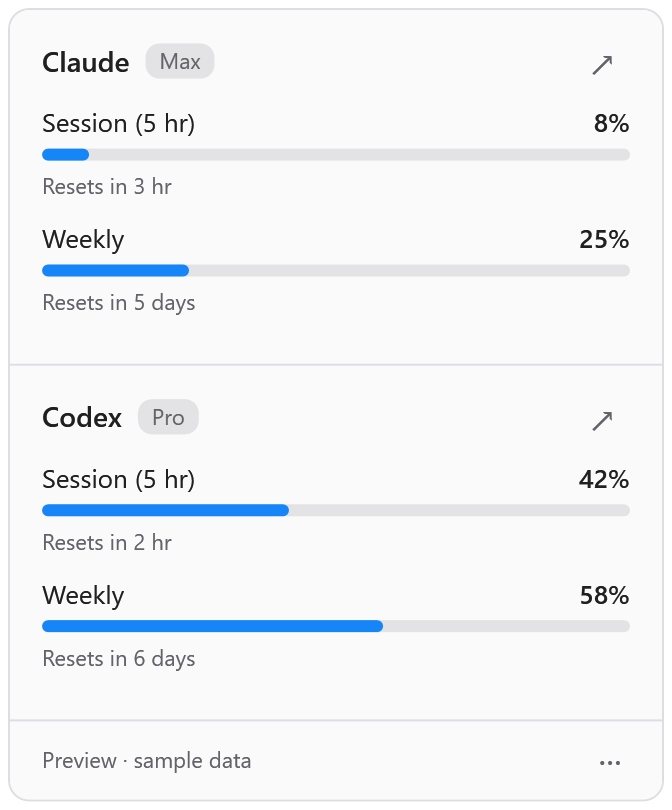

# AI Meter for Windows

A C# desktop app for Windows 11. It shows Claude and Codex plan usage in the
notification area. It uses .NET 10, WPF, and the built-in Windows Forms tray icon.
It does not need a web server or a background service.

Click the tray icon to open the panel. Each normal meter shows the percentage
**used**: blue below 70%, orange from 70%, and red from 90%. The tooltip shows
each provider's highest usage percentage. The panel shows all reported windows,
reset times, plan names, and links to the provider usage pages.

| Light | Dark |
| --- | --- |
|  |  |

## Build and run

Install Visual Studio 2026 Community with **.NET desktop development** and the
.NET 10 SDK. Open `AIMeter.slnx`, or run these commands from this directory:

```powershell
.\build.ps1 -Test -Publish
.\build\win-x64\AIMeter.exe
```

The build script uses Visual Studio Community's MSBuild and test runner.
The publish folder includes the .NET runtime, LICENSE, and NOTICE. Keep the
whole folder together. The executable is not signed; Windows can show a warning
for downloaded files. No installer or administrator access is required. Keep
Codex on your user PATH. The app folder does not need to be on PATH.

Use **Start at Login** in the tray menu or the panel's **More options** menu to
start this copy when you sign in. Leave the app in a stable folder before you
enable this option. **Quit AI Meter** stops checks and removes the tray icon.
Escape or a click outside the panel closes the panel without stopping the app.
Starting a second copy opens the first copy's panel.

## Credentials and requests

- Claude: read `%USERPROFILE%\.claude\.credentials.json`, or the directory in
  `CLAUDE_CONFIG_DIR`. Send the saved OAuth token to
  `https://api.anthropic.com/api/oauth/usage`.
- Codex: run the installed `codex app-server`, read the account with
  `refreshToken: false`, and request `account/rateLimits/read`. Sign in with a
  ChatGPT account; API-key accounts do not provide these plan limits.

Use native Windows CLI sign-ins. WSL sign-ins are not used. Environment variables
come from the process that starts AI Meter. Variables set only in one PowerShell
session do not reach an app started by Explorer or at login.

AI Meter does not write credentials or force token renewal. The Codex CLI can
renew its own expired tokens and write its own state. HTTP 403 means that the
Claude usage service denied access; it does not prove that the CLI is signed out.
The provider interfaces are informal and can change without notice.

## Polling and retries

Each provider is checked at startup. After success, it waits five minutes.
Opening the panel does not make a request. A failure replaces that provider's
meters with an error and the next check time. The footer shows the last check
time, not the last successful response.

The retry rule matches macOS and Ubuntu: independent exponential delays with
equal jitter of 5–10, 10–20, 20–40, then 30–60 minutes. A longer Claude
`Retry-After` value takes priority. A success resets that provider's retry state.
Deadlines use a monotonic clock and are checked once per minute. Restarting the
app clears the in-memory retry state. Requests have timeouts; shutdown cancels
pending work, closes Codex input, and stops the child if it does not exit.

## Checks and screenshots

```powershell
.\build.ps1 -Test
$app = '.\AIMeter\bin\Release\net10.0-windows\AIMeter.exe'

# Live check. Writes usage and error summaries, never tokens. Exit 1 means failure.
$check = Start-Process $app -ArgumentList "--check `"$PWD\usage.json`"" -Wait -PassThru
$check.ExitCode

# Render the actual panel with sample data. These commands make no requests.
& $app --preview normal --theme light --capture "$PWD\panel-light.png"
& $app --preview normal --theme dark --capture "$PWD\panel-dark.png"
& $app --preview warnings --theme dark --capture "$PWD\warnings.png"
& $app --preview unavailable --theme dark --capture "$PWD\unavailable.png"
& $app --preview loading --theme light --capture "$PWD\loading.png"
```

Captures use WPF rendering at 2× resolution. Use `--scale 1` for 1×.
Preview footers identify sample data. `--show` opens the real panel at startup.
Offline tests cover parsing, HTTP errors, the Codex protocol and process cleanup,
retry growth and jitter, the cap, provider independence, cancellation, and reset
after success. Live service access and Windows login must be checked separately.

Read the [security policy](../SECURITY.md) and [disclaimers](../DISCLAIMER.md).
This project is licensed under [Apache-2.0](../LICENSE).
